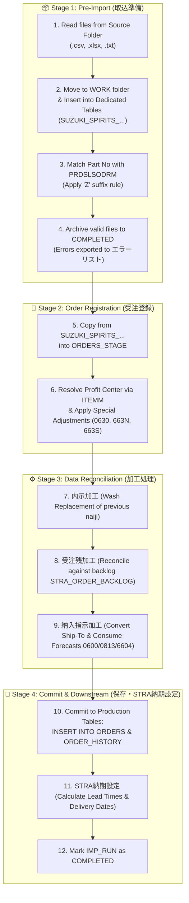

# 🚀 Suzuki SPIRITS Order Import Pipeline Summary (End-to-End)

This document provides a concise, high-level summary of the entire Suzuki SPIRITS data import and processing pipeline—from file intake in **Stage 1** through **Stage 2**, reconciliation processing, and downstream **STRA delivery scheduling**.

---

## 🗺️ Complete Pipeline Flowchart

---

## 📦 Stage 1: 取込準備 (Pre-Import & Staging)
* **Goal**: Pick up new raw files from the source folder, store them safely into dedicated database tables, and validate ASTI part numbers.

1. **File Search & Move**: 
   - Scans `FOLDER_MST.FOLDER_PATH` (`C:\ASTI\DATA\SUZUKI\IN\`) for `*.csv`, `*.xlsx`, and `*.txt`.
   - Moves discovered files into the user/batch working directory: `C:\ASTI\DATA\WORK\[UserId]\[CustomerCode]\[FolderType]\` (uses `SUZUKI-AT\5455\4\` for batch).
2. **Raw Staging Insert (`INSERT SUZUKI_SPIRITS_...`)**:
   - Parses each row and routes to its dedicated table based on Column 1 (`INFO_TYPE_CODE`):
     - `0501, 0502` $\rightarrow$ `SUZUKI_SPIRITS_0501AND0502`
     - `0600, 0630` $\rightarrow$ `SUZUKI_SPIRITS_0600AND0630`
     - `0602` $\rightarrow$ `SUZUKI_SPIRITS_0602`
     - `0650` $\rightarrow$ `SUZUKI_SPIRITS_0650`
     - `0651` $\rightarrow$ `SUZUKI_SPIRITS_0651`
     - `0740` $\rightarrow$ `SUZUKI_SPIRITS_0740`
     - `0813` $\rightarrow$ `SUZUKI_SPIRITS_0813`
     - `0814` $\rightarrow$ `SUZUKI_SPIRITS_0814`
     - `6604, 6634` $\rightarrow$ `SUZUKI_SPIRITS_6604AND6634`
     - `6624` $\rightarrow$ `SUZUKI_SPIRITS_6624`
     - `663N, 663S, 664T` $\rightarrow$ `SUZUKI_SPIRITS_663NAND663SAND664T`
   - Sets `CREATED_PG_ID = 'OrderImport(Stage)'`.
3. **Invalidation (`ACTIVE_FLAG = 'N'`)**:
   - Compares publication date/time (or acceptance date for 0740) against prior records. Older active records are updated to `ACTIVE_FLAG = 'N'`.
4. **Part Number Matching (`PRDSLSODRM`)**:
   - Matches `CUSTOMER_ITEM_NO` against `PRDSLSODRM.FCUSTITEMNO` to populate `ITEM_NO` (`FPRDCD`).
   - **'Z' Suffix Rule**: For codes `6604`, `6624`, `6634`, `663N`, `663S`, `664T`, matches part numbers ending with **'Z'**; all other codes match part numbers without 'Z'.
5. **Error & File Handling**:
   - If part numbers cannot be matched:
     - Exports Excel error list to `[FOLDER_PATH]\エラーリスト\`.
     - Copies original file back as `[OriginalName]_[UserID]_[Timestamp]`.
     - Deletes unmapped records from the staging table.
   - **File Archiving Lifecycle**:
     - **Web UI Mode**: Discovered files remain in the `WORK/` directory with `STATUS = 'DISCOVERED'` in `IMP_FILES_STAGE`. When the operator clicks **[保存] (Save)** on `OrderImport.aspx`, files are moved to `COMPLETED/` as `[FileName]_[User]_[Timestamp].[ext]`. If the operator clicks **[破棄] (Discard)**, files are moved from `WORK/` back to the source input folder (`FOLDER_PATH`).
     - **Batch Mode**: Because Stage 1 automatically proceeds through Stage 2 and Save, files are moved to `COMPLETED/` at the end of the automated pipeline.

---

## 📝 Stage 2: 受注登録 (Order Transformation & Staging)
* **Goal**: Convert staged Suzuki records into ASTI's standardized order staging table (`ORDERS_STAGE`).

1. **Stage Cleaning**: 
   - Purges any existing uncommitted records in `ORDERS_STAGE` for customer `5455` and `FOLDER_TYPE = 4`.
2. **Transform to `ORDERS_STAGE`**:
   - Reads active records (`ACTIVE_FLAG = 'Y'`) for valid order codes: `0600`, `0602`, `0650`, `0651`, `0813`, `0814`, `6604`, `6624` (skipping `0630`, `663N`, `663S` on initial insert).
   - Sets order classification:
     - `ORDER_TYPE = 1` (内示 / Forecast) for `0600`, `0602`, `0813`, `6604`.
     - `ORDER_TYPE = 3` (納入指示 / Delivery Instruction) for `0650`, `0651`, `0814`, `6624`.
   - Calculates working delivery dates:
     - `DUE_DATE = ADD_WORKING_DAYS2('00001', [DELIVERY_DATE], 0)`.
   - Maps code conversions:
     - `PRORATED_TYPE`: `1:年月` or `4:年週` $\rightarrow$ `2:日割以外`; `5:年月日` or `6:年月日時分` $\rightarrow$ `1:日割り`.
     - `CUSTOMER_INFO_TYPE`: `1:内示` $\rightarrow$ `新規`, `2:確定` $\rightarrow$ `新規`, `3:変更` $\rightarrow$ `変更`.
     - Special `0651`: If 17th digit of `ORDER_NOTES` is not `'0'` $\rightarrow$ `打切`.
3. **Profit Center Resolution**:
   - Queries `USRDEFFLDF` (`ITEMM`) using `PRODUCT_CODE` to retrieve the real Profit Center (`FUSRSTR1`).
   - Updates `ORDERS_STAGE.CUSTOMER_SETTING_ID` with the specific Profit Center setting.
   - *(If unresolved, flags an error to prevent registering under the dummy setting)*.
4. **Special Demand Adjustments**:
   - **`0630` (増減)**: Adds adjustment quantity to matching `0600` record (`ORDERS_STAGE.DEMAND_QTY + 0630_QTY`).
   - **`663N` (納期変更)**: Updates `DUE_DATE` on matching `6624` firm order.
   - **`663S` (数量変更)**: Updates `DEMAND_QTY` on matching `6624` firm order.

---

## ⚙️ Stage 3: 加工処理 (Reconciliation & Invalidation)
* **Goal**: Cleanly wash replace older forecasts, reconcile against outstanding order backlog, and consume forecasts against delivery instructions.

### 1. 内示加工 (Forecast Wash Replacement per `内示加工.pdf`)
* Counts customer naiji ($x$: `SELF_FCST_FLAG = 'N'`) and ASTI manual naiji ($y$: `SELF_FCST_FLAG = 'Y'`):
  - **Case ① ($x \ge 1, y = 0$)**: Invalidate prior customer forecasts (`SELF_FCST_FLAG = 'N'`) and auto-delete ASTI naiji (`SELF_FCST_DELETE_FLAG = 'Y'`).
  - **Case ② ($x = 0, y \ge 1$)**: Invalidate prior ASTI manual forecasts (`SELF_FCST_FLAG = 'Y'`).
  - **Case ③ ($x \ge 1, y \ge 1$)**: Invalidate all prior forecasts.
* **Special Rule `0602`**: Has no reference date fields $\rightarrow$ treated as pure new data (skips wash replacement).
* Sets newly processed naiji status to `STATUS = 'PROCESSED'`.

### 2. 受注残加工 (Backlog Reconciliation per `受注残加工.pdf`)
* When `RECONCILE_FLAG = 'Y'`:
  - Queries `STRA_ORDER_BACKLOG` and reconciles demand quantities against orders based on `RECONCILE_TYPE` (`1: 順次`, `2: 同月まで`, `3: 同月のみ`).
  - When remaining `DEMAND_QTY = 0`: sets `STATUS = 'RECONCILED'` and `ACTIVE_FLAG = 'N'`.

### 3. 納入指示加工 (Delivery Instruction Processing per `納入指示加工.pdf`)
1. **打切 (Termination)**: Records where `ORDER_TYPE = 3` and `INFO_TYPE = 'N'` $\rightarrow$ `STATUS = 'PROCESSED'`, `ACTIVE_FLAG = 'N'`.
2. **取消 (Cancellation)**: Records where `ORDER_TYPE = 3` and `INFO_TYPE = 'D'` $\rightarrow$ `DEMAND_QTY = 0`, `STATUS = 'PROCESSED'`.
3. **確定消込 (Firm Order Deduction)**: Matches `CUSTOMER_ORDER_NO` against prior firm orders (`ORDER_TYPE = 2`) and deducts `DEMAND_QTY`.
4. **出荷先変換 (Destination Conversion)**: Replaces `SHIP_TO` with internal shipping platform code `DELIVERY_CODE_PLAN` from `SUZUKI_SPIRITS_CONVERSION_MST` (where `DELIVERY_CODE_ORDER = SHIP_TO`).
5. **内示消込 (Forecast Consumption)**:
   - When `FCST_RECONCILE_FLAG = 'Y'`:
     - `0650 / 0651` consumes active `0600` forecasts.
     - `0814` consumes active `0813` forecasts.
     - `6624` consumes active `6604` forecasts.
6. **新規納入指示確定**: Marks remaining new delivery instructions as `STATUS = 'PROCESSED'`.

---

## 💾 Stage 4: 保存 & 納期設定 (Commit & Delivery Scheduling)
* **Goal**: Commit processed orders to production master tables and schedule production delivery dates.

1. **Commit to `ORDERS` & `ORDER_HISTORY`**:
   - Inserts valid processed rows from `ORDERS_STAGE` into master production table **`ORDERS`**.
   - Appends audit snapshot entries into **`ORDER_HISTORY`**.
   - Updates `SUZUKI_SPIRITS_...` staging tables: `STATUS = 'REGISTERED'`, `IMP_FILE_ID = :impFileId`.
   - Inserts record into `IMP_FILES` (`STATUS = 'PARSED'`) and deletes from `IMP_FILES_STAGE`.
2. **STRA納期設定 (STRA Delivery Scheduling per `STRA納期設定ページ_受注取込後.pdf`)**:
   - Calculates lead times for each order:
     - **品揃リードタイム (Kit Lead Time)**: `SELECT FUSRDEC1 FROM USRDEFFLDF WHERE FTABLEID='ITEMM' AND FRECKEY = ITEM_NO`
     - **輸送L/T (Transport Lead Time)**: `SELECT FTRANLT FROM SHPROUTM WHERE FSHPTOCD = SHIP_TO AND FPRMWHCD = SHIP_STOCK_LOCATION ...`
   - Calculates working dates via `ADD_WORKING_DAYS`:
     - **出荷予定日 (`SHIP_SCHEDULED_DATE`)**: `希望納期 - (輸送L/T + 品揃L/T)`
     - **出荷日 (`SHIP_DATE`)**: `希望納期 - 輸送L/T`
     - **出荷計画日 (`SHIP_PLAN_DATE`)**: `希望納期 - (輸送L/T + 品揃L/T)`
   - Updates `ORDERS`: `SHIP_SCHEDULED_DATE`, `SHIP_DATE`, `SHIP_PLAN_DATE`, `STATUS = 'DUE_SET'`, `UPDATED_PG_ID = 'DueDateSetting(Order)'`.
   - Appends snapshot into `ORDER_HISTORY` with `STATUS = 'DUE_SET'`.
3. **Finalize Run**:
   - Updates `IMP_RUN`: `ENDED_AT = SYSDATE`, `STATUS = 'COMPLETED'`, `FILE_COUNT`, `ROW_COUNT`, `ERROR_COUNT`.

---

## 💻 Web UI vs. 🤖 Batch Execution Comparison

| Feature | 💻 Web UI Mode (`OrderImportStage.aspx` / `OrderImport.aspx`) | 🤖 Batch Mode (`SUZUKI_SPIRITS_DATA_IMPORT.exe /batch`) |
| :--- | :--- | :--- |
| **Trigger** | Manual button click by operator | Automated via Windows Task Scheduler |
| **Execution Flow** | **Step-by-step with pause points**: 1. Stage 1 executes $\rightarrow$ displays grid for operator review. 2. Operator navigates to Stage 2 $\rightarrow$ executes $\rightarrow$ displays grid. 3. Operator clicks [保存] to commit. | **Fully automated single pipeline**: Runs Stage 1 $\rightarrow$ Stage 2 $\rightarrow$ Reconciliation $\rightarrow$ Save $\rightarrow$ STRA納期設定 from start to finish. |
| **Audit User (`CREATED_USER_ID`)** | Authenticated Login User ID (e.g. `EMP1040`) | Hardcoded OS Batch User `'SUZUKI-AT'` |
| **Customer Settings** | Selected row on the screen | Filtered for `CUSTOMER_CODE = '5455'` with empty Profit Center |
| **Folder Type** | Selected by user | Fixed to `FOLDER_TYPE = 4` (混在 / Mixed) |
| **Error Feedback** | Shown in on-screen label/grid (`lblError`) | Exported as Excel error report to `[FOLDER_PATH]\エラーリスト\` |
