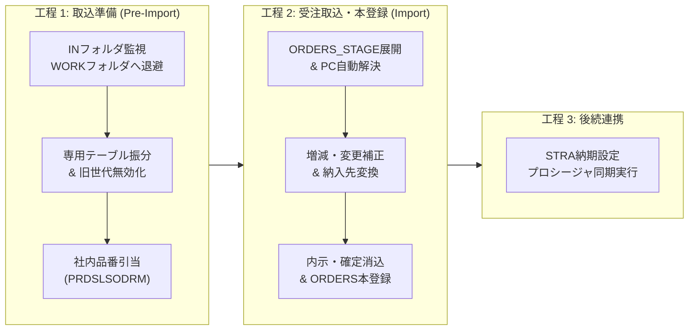

<style>
  /* 印刷・PDF出力用スタイル設定 */
  @media print {
    @page {
      margin: 15mm 12mm 15mm 12mm;
    }
  }

  body {
    font-size: 10.5pt;
    line-height: 1.5;
  }

  /* 見出しがページの最下部に孤立（改ページで詳細と泣き別れ）するのを防止 */
  h1, h2, h3, h4, h5, h6 {
    page-break-after: avoid !important;
    break-after: avoid !important;
    break-after: avoid-page !important;
    margin-top: 14px;
    margin-bottom: 8px;
  }

  /* Chromium対策: 見出しの直後の要素も手前での改ページを禁止 */
  h1 + *, h2 + *, h3 + *, h4 + *, h5 + *, h6 + * {
    page-break-before: avoid !important;
    break-before: avoid !important;
    break-before: avoid-page !important;
  }

  /* リスト項目の途中改ページ防止 */
  li {
    page-break-inside: avoid !important;
    break-inside: avoid !important;
  }

  /* コードブロックの途中分割を防止（overflow: visible が必須） */
  pre, code, pre code {
    page-break-inside: avoid !important;
    break-inside: avoid !important;
    overflow: visible !important;
    white-space: pre-wrap !important;
    word-break: break-all;
  }

  /* 表のページ跨ぎ制御 */
  table {
    page-break-inside: auto;
    border-collapse: collapse;
    width: 100%;
  }
  thead {
    display: table-header-group !important; /* 改ページ時も表ヘッダーを反復 */
  }
  tr {
    page-break-inside: avoid !important;
    break-inside: avoid !important;
  }
</style>

# SPIRITS スズキ受注データ取込機能 開発引継ぎ書・仕様解説書

---

## 1. 概要・システム開発スコープ

* **対象システム**: ASTI 受注データ抽出システム（OMS）
* **対象顧客**: スズキ株式会社（顧客コード：`5455`）
* **対象データ**: スズキSPIRITSデータ（固定長テキスト、情報区分コード `0501` ～ `664T`）
* **主要コンポーネント**:
  1. `SUZUKI_SPIRITS_DATA_IMPORT.exe`（バッチ実行コンソールアプリケーション）
  2. `OMS.Business`（コア業務ロジック：`SuzukiPreImportService.vb`, `SuzukiDataImportService.vb` 等）
  3. `OMS.Data`（Oracle DBアクセス層：`OrderStageRepository.vb`, `OrderStageImport.vb` 等）
  4. `OMS.Web`（Web画面：`OrderImportStage.aspx`, `OrderImport.aspx`, `DueDateSettingFromImport.aspx`）

---

## 2. システム構成・改修対象ファイル一覧

本リポジトリにおけるスズキ機能の実装・改修対象ファイルの内訳および主要メソッドの役割は以下の通りです。
※後任者への引継ぎにおける可読性と保守性を重視し、内部の軽微なユーティリティ（文字列トリムや型変換等のヘルパー）は割愛し、業務ロジックのコアとなる主要メソッドを中心に解説しています。

### 2.1 新規作成コンポーネント

#### 1. `SUZUKI_SPIRITS_DATA_IMPORT/`（バッチ実行コンソールアプリケーション）
* **`SuzukiSpiritsDataImport.vb`**
  * **役割**: スズキSPIRITS専用のバッチ実行エントリポイント。引数省略時の全自動パイプライン実行、および個別手動検証用引数の解析。
  * **主要関数・メソッド**:
    * `Main(args As String())`: コマンドライン引数解析（`/batch`, `/user:`, `/folder:`, `/customersettingid:`, `/profitcenter:`）、工程 1（取込準備）および 工程 2（受注取込）の順次呼び出し、エラー制御と終了コード管理。
    * `GetSuzukiFolderPath(customerSettingId As Long)`: `FOLDER_MST` から混在取込フォルダ（種別: 4）の物理パスを取得。
    * `GetSuzukiCustomerSettingId(profitCenter As String)`: `CUSTOMER_SETTING_MST` からスズキ（5455）のデフォルト取引先設定IDを取得。
* **`App.config`**
  * **役割**: DB接続文字列（Oracle `OMSDB`）、混在フォルダパス、ログ出力先等の環境依存設定。ビルド時に `SUZUKI_SPIRITS_DATA_IMPORT.exe.config` として出力。

#### 2. `OMS.Business/`（業務ロジック層）
* **`Services/SuzukiPreImportService.vb`**
  * **役割**: 【工程 1: 取込準備】。INフォルダ監視、WORK退避、ファイル形式判別、専用ステージングテーブルへの格納、社内品番引当、部分エラー行の分離出力。
  * **主要関数・メソッド**:
    * `ExecuteImport(...)`: 取込準備の総合エントリ。実行管理レコード（`IMP_RUN`）採番、ファイル移動、パーサー呼び出し、ステージング登録、品番引当、エラー行分離とCSV出力、バッチモード時の後続自動呼び出しを一括制御。
    * `InvalidatePreviousMonthNagareOrders(...)`: 前月度の「ながれ納入（`DELIVERY_TYPE LIKE '%NN%'`）」内示データ（0600）を無効化（`ACTIVE_FLAG = 'N'`）。
    * `GetPreviousMonthSymbol(refDate As DateTime)`: SPIRITS仕様に基づき、前月の生産月度記号（A～N、I・L除外）を算出。
    * `UpdateAstiPartNumbers(...)`: `PRDSLSODRM` マスタを参照して ASTI社内品番（`ITEM_NO`）を解決。注文系コード（6600系）は末尾 `'Z'` 品番を優先引当。
    * `ExportErrorsToCsv(...)` / `DeleteErrorRows(...)`: 品番未引当行をCSV（`エラーリスト/`）へ出力し、ステージングから除外（正常行は残して後続登録へ進める部分エラー許容設計）。
* **`Services/SuzukiDataImportService.vb`**
  * **役割**: 【工程 2: 受注取込・本登録】。ステージングからのデータ抽出、プロフィットセンター（PC）動的判定、増減・変更補正、納入先変換、内示消込、`ORDERS` 本テーブル登録、STRA納期設定。
  * **主要関数・メソッド**:
    * `ExecuteOrderRegistration(...)`: 受注本登録の総合エントリ。前世代ワーク初期化、ステージングデータ展開、納入先変換、消込処理、`ORDERS`・履歴登録、完了ファイル退避、STRA納期設定呼出を一括制御。
    * `ExecuteStageImportToOrdersStage(...)`: スズキ専用ステージングテーブル（0600, 0650, 6604等）から有効データを抽出し、PC解決・補正を適用して `ORDERS_STAGE` に展開。
    * `ResolveProfitCenters(...)`: Oracleの `USRDEFFLDF` テーブル（`ITEMM`）より品目別のプロフィットセンター（`FUSRSTR1` / PC）を解決し、対応する `CUSTOMER_SETTING_ID` を自動設定。
    * `ApplyAdjustment0630(...)` / `ApplyAdjustment663N(...)` / `ApplyAdjustment663S(...)`: 内示増減（0630）および二輪注文変更（663N/663S）の補正。同バッチ内に親データが無い場合は既存の `ORDERS` 本番テーブルから逆引きフォールバック。
    * `MoveWorkFilesToCompleted(...)`: 今回のバッチで実際に本登録まで到達したファイルのみを選択的に `COMPLETED` フォルダへアーカイブ。
    * `ExecuteStraDeliveryDateSetting(...)`: バッチ実行時、後続のSTRA納期計算ストアドプロシージャ（`SP_UPDATE_STRA_DUE_DATE`）を同期実行。
* **`Services/SuzukiCsvParser.vb`**
  * **役割**: スズキSPIRITS固定長／可変長テキストの高速解析エンジン。文字コード自動判別（Shift-JIS / UTF-8 BOM対応）およびExcel保存時の0落ち検知。
  * **主要関数・メソッド**:
    * `PeekInfoTypeCode(filePath As String)`: 1行目の先頭4桁コードを検査し、情報区分コード（`0600`, `0650`, `6604` 等）を判定。
    * 各種専用パース関数:
      * `Parse0600And0630`: 月次内示および増減データ
      * `Parse0602`: 追加内示データ
      * `ParseSpirits0650`: 通常納入指示（確定）
      * `ParseSpirits0651`: 臨時納入指示（確定）
      * `ParseSpirits0814`: 支給品納入指示（確定）
      * `ParseSpirits6604And6634`: 二輪・汎用注文内示および変更
      * `ParseSpirits6624`: 二輪・汎用注文確定
      * `ParseSpirits663NAnd663SAnd664T`: 二輪・汎用納期・数量変更および打切
      * `ParseSpirits0501And0502` / `ParseSpirits0740`: 内示・検収データ

### 2.2 機能追加・改修コンポーネント

* **`OMS.Data/`**（データアクセス層）
  * **`OrderStageRepository.vb`**
    * `DeleteOrdersStageForSuzuki`: 他顧客に影響を与えずスズキ専用ワーク行のみを安全に初期化。
    * `ConvertShipToForSuzuki`: `SUZUKI_SPIRITS_CONVERSION_MST` を参照し納入先を出荷先に変換。
    * `ReconcileForecastSuzuki`: スズキ専用の確定納入指示による内示消込ロジック。
    * `DeliveryDateSetting`: `SP_UPDATE_STRA_DUE_DATE` の呼び出しラッパー。
  * **`OrderStageImport.vb`**
    * `ImportOrdersStage`: 顧客コードが `5455` の場合に既存の標準取込処理をバイパスし、スズキ専用エンジン（`SuzukiDataImportService`）へディスパッチ。
* **`OMS.Web/`**（Web管理画面層）
  * **`Pages/Orders/OrderImportStage.aspx.vb`**: 取込準備画面。一覧（GridView）のチェックボックスでスズキ（5455）が選択された場合に `SuzukiPreImportService.ExecuteImport` を呼び出し。
  * **`Pages/Orders/OrderImport.aspx.vb`**: 受注取込画面。一覧（GridView）のチェックボックスでスズキデータが選択された場合に `SuzukiDataImportService.ExecuteOrderRegistration` を呼び出し。

### 2.3 連携先既存コンポーネント
* `OMS.Data/DbAccess.vb`: DB接続・トランザクション基盤
* `OMS.Common/Logger.vb`: ファイルロガー
* `OMS.Web/Pages/Orders/DueDateSettingFromImport.aspx`: STRA納期設定画面


---

## 3. 処理フロー詳細

スズキSPIRITSデータ取込は、**工程 1: 取込準備 (Pre-Import)**、**工程 2: 受注取込・本登録 (Import)**、および後続の **工程 3: STRA納期設定** の3工程で構成されます。

### 3.1 概要パイプライン



### 3.2 詳細ステップ解説

#### 【工程 1】取込準備 (`SuzukiPreImportService`)
1. **設定値取得**:
   * `CUSTOMER_SETTING_MST` より得意先コード `5455`、PCブランクの設定を取得。
   * `FOLDER_MST` よりスズキ用取込フォルダ種別（`FOLDER_TYPE = 4`: 混在）のパスを取得。
2. **ファイル取得と作業退避**:
   * 監視元フォルダ（`IN`）から作業用フォルダ（`WORK/[UserID]/...`）へファイルを移動。
3. **実行管理レコード作成**:
   * `IMP_RUN`（実行ID採番、ステータス: `RUNNING`）および `IMP_FILES_STAGE` を登録。
4. **情報区分（`INFO_TYPE_CODE`）による専用テーブル振分**:
   * 各行の先頭4桁コードに基づき、対応する専用ステージングテーブルに格納（第5章参照）。
5. **既登録データの無効化**:
   * 同一キー（客先品目No、発行日、発行時刻等）の旧データを `ACTIVE_FLAG = 'N'` に更新。
6. **社内品番（`ITEM_NO`）引当**:
   * 取引先品番マスタ `PRDSLSODRM` を参照し、`CUSTOMER_ITEM_NO` から ASTI社内品番 `ITEM_NO` を解決。
   * **仕様書規定ルール**: 注文系コード（`6604`, `6624`, `6634`, `663N`, `663S`, `664T`）は**末尾 `'Z'` の品番**を引当。その他のコードは「Z無し」を引当。
7. **品番引当エラー時の挙動（部分エラー許容設計）**:
   * **全行エラーの場合（正常行0件）**:
     * エラーリストCSVを出力し、対象ファイルを元の取込元フォルダへ戻してロールバック。
   * **一部行エラーの場合（例: 16行中6行がエラー、10行が正常）**:
     * 未引当の6行のみステージングから削除し、エラー内容をCSVファイル（`[フォルダ]\エラーリスト\` 配下）に出力。
     * 元ファイルのバックアップを取込元フォルダに複製保存。
     * **正常な10行はそのままステージングに確定され、工程2（受注取込・本登録）へ進んで `ORDERS` へ正常登録されます。**

#### 【工程 2】受注取込・本登録 (`SuzukiDataImportService`)
1. **ORDERS_STAGE 初期化**:
   * 該当得意先・フォルダ種別の前世代ワークデータを削除（バッチ実行時は実行単位で安全にパージ）。
2. **ベースデータ登録**:
   * 内示（`0600`, `0602`, `6604`）および確定（`0650`, `0651`, `0814`, `6624`）を `ORDERS_STAGE` に展開。
   * ※ `0630`, `663N`, `663S` はベース行としては登録せず、後続の更新処理用として待機。
3. **プロフィットセンター（PC）解決**:
   * `USRDEFFLDF`（`FTABLEID = 'ITEMM'`）から該当品番の `FUSRSTR1`（PC）を取得。
   * 取得したPCに対応する `CUSTOMER_SETTING_ID` へ `ORDERS_STAGE` を自動更新。
4. **差分・増減データの反映**:
   * `0630`（内示増減）: 対象の `0600`（月次内示）の需要数（`DEMAND_QTY`）を加減算。
   * `663N` / `663S`（納期・数量変更）: 対象の `6624` の納期・数量を補正。
5. **納入先変換**:
   * `SUZUKI_SPIRITS_CONVERSION_MST` を参照し、納入先コードを出荷先コードに変換。
6. **消込処理（Reconciliation）**:
   * 確定納入指示データにより、先行する内示データの需要数を消化・消込（残数0で `STATUS = 'RECONCILED'`, `ACTIVE_FLAG = 'N'`）。
7. **ORDERS 本テーブル登録**:
   * 確定した `ORDERS_STAGE` データを本番テーブル `ORDERS` に INSERT/UPDATE し、変更履歴を `ORDER_HISTORY` に記録。
8. **選択的ファイル完了移動**:
   * 本バッチで実際に登録処理が行われたファイルのみを作業フォルダから `COMPLETED` フォルダへ移動。
9. **STRA 納期設定呼出**:
   * バッチ実行時のみ、後続の `STRA納期設定` プロシージャを同期実行。

---

## 4. フォルダ体系とファイルライフサイクル

```
【取込元フォルダ】（FOLDER_MST.FOLDER_PATH より動的取得。標準設定例: C:\ASTI\Order\Suzuki\）
└── エラーリスト\                # 【エラー退避】マスタ未引当等のエラー発生時にCSVレポートを出力

C:\ASTI\DATA\（Web.config / App.config の WorkFolderRoot / CompletedFolderRoot 設定）
├── WORK\SUZUKI-AT\5455\4\        # 【作業中フォルダ】取込開始時に退避され、解析・処理が行われる
└── COMPLETED\SUZUKI-AT\5455\4\   # 【完了アーカイブ】正常に本登録まで完了したファイルを退避
```

* **取込元フォルダ（`FOLDER_PATH`）**:
  * 固定パスではなく、DBマスタ `FOLDER_MST.FOLDER_PATH`（`CUSTOMER_CODE = '5455'` かつ `FOLDER_TYPE = 4: 混在`）から動的に取得されます（標準設定例: `C:\ASTI\Order\Suzuki\`）。
  * スズキから受信（またはSPIRITSより出力）したCSVファイルは、サブフォルダを作成せず取込元フォルダ直下に直接配置します。
  * マスタ未引当等のエラー発生時は、当該取込元フォルダの直下に `エラーリスト\` フォルダが自動作成され、エラーレポートが出力されます。
* **作業用および完了アーカイブ（`WORK` / `COMPLETED`）**:
  * アプリケーション内部の退避領域であり、`[Root]\[UserId]\[CustomerCode]\[FolderType]\` の階層構造（例: `C:\ASTI\DATA\WORK\SUZUKI-AT\5455\4\`）で自動生成・管理されます。

### ファイル移動ルール（選択的移動）
* `SuzukiDataImportService.MoveWorkFilesToCompleted` において、`ORDERS_STAGE` から実際に本登録処理が実行された `IMP_FILE_STAGE_ID` のファイルを特定し、該当ファイルのみを `WORK` から `COMPLETED` フォルダへ移動します。
* 手動取込用ファイル（例: `ASTI_TUIKA_NAIJI_TEST.xlsx`）など、本バッチで処理されなかったファイルは `WORK` フォルダにそのまま保持され、Web画面からの取込操作に影響を与えません。

---

## 5. スズキ専用ステージングテーブル一覧

SPIRITSファイルの1行目の情報区分コード（4桁）により、以下のテーブルに格納されます。

| 情報区分 | 日本語名称 | 格納先ステージングテーブル | 本登録先 (`ORDERS`) | ASTI品番 Z付加判定（仕様書規定） |
| :---: | :--- | :--- | :---: | :---: |
| **0501** | 内示データ（確定） | `SUZUKI_SPIRITS_0501AND0502` | — (取込のみ) | 対象外（完全一致） |
| **0502** | 内示データ（内示） | `SUZUKI_SPIRITS_0501AND0502` | — (取込のみ) | 対象外（完全一致） |
| **0600** | 確定受注データ（月次内示） | `SUZUKI_SPIRITS_0600AND0630` | **登録** (種別: 1) | 対象外（完全一致） |
| **0602** | 確定受注データ（追加内示） | `SUZUKI_SPIRITS_0602` | **登録** (種別: 1) | 対象外（完全一致） |
| **0630** | 確定受注データ（内示増減） | `SUZUKI_SPIRITS_0600AND0630` | **0600の加算補正** | 対象外（完全一致） |
| **0650** | 納入指示データ（通常） | `SUZUKI_SPIRITS_0650` | **登録** (種別: 3) | 対象外（完全一致） |
| **0651** | 納入指示データ（臨時） | `SUZUKI_SPIRITS_0651` | **登録** (種別: 3) | 対象外（完全一致） |
| **0740** | 検収データ | `SUZUKI_SPIRITS_0740` | — (検収照合用) | 対象外（完全一致） |
| **0813** | 支給品情報データ（内示） | `SUZUKI_SPIRITS_0813` | — (仕様変更により対象外) | 対象外 |
| **0814** | 支給品納入指示データ（確定） | `SUZUKI_SPIRITS_0814` | **登録** (種別: 3) | 対象外（完全一致） |
| **6604** | 注文データ（内示） | `SUZUKI_SPIRITS_6604AND6634` | **登録** (種別: 1) | **対象 (末尾'Z')** |
| **6624** | 注文データ（確定/指示） | `SUZUKI_SPIRITS_6624` | **登録** (種別: 3) | **対象 (末尾'Z')** |
| **6634** | 注文データ（変更） | `SUZUKI_SPIRITS_6604AND6634` | — (変更照合用) | **対象 (末尾'Z')** |
| **663N** | 注文データ（納期変更） | `SUZUKI_SPIRITS_663NAND663SAND664T` | **6624の納期補正** | **対象 (末尾'Z')** |
| **663S** | 注文データ（数量変更） | `SUZUKI_SPIRITS_663NAND663SAND664T` | **6624の数量補正** | **対象 (末尾'Z')** |
| **664T** | 注文データ（打切/取消） | `SUZUKI_SPIRITS_663NAND663SAND664T` | — (打切照合用) | **対象 (末尾'Z')** |

---

## 6. 特殊業務ロジック解説

### 6.1 `0600`系（自動車・部品内示）のライフサイクルロジック
* **`0600`（月次内示）の「全件洗い替え」**:
  * 毎月スズキから送信される月次基準計画データです。
  * 新しい `0600` が取り込まれると、既存の過去 `0600` データは `STATUS = 'REPLACED'`、`ACTIVE_FLAG = 'N'` に更新され、最新のデータのみが `ACTIVE_FLAG = 'Y'` として有効化されます。
* **`0602`（追加内示）および `0650`/`0814`（確定納入指示）の累積保持**:
  * `0600` とは異なり、都度追加される確定・準確定オーダーです。
  * `0600` のような一括洗い替えの対象にはならず、明示的な納入指示消込や個別キャンセルがない限り、`ACTIVE_FLAG = 'Y'` を維持します。
* **`0630`（内示増減）の加算ロジックとフォールバック**:
  * `0630` は独立した受注行を作成せず、直前の `0600` の数量を増減させるデータです。
  * 名寄せキー: `ITEM_NO`, `PRE_DAILY_DELIVERY_DATE`, `TARGET_REFERENCE_DATE_TYPE`, `TARGET_REFERENCE_DATE`
  * 通常は同一バッチ内の `ORDERS_STAGE` 上の `0600` を直接加算します。
  * 同日バッチ内にベースとなる `0600` が存在しない場合（過去に取り込まれた `ORDERS` 本番テーブルにのみ存在する場合）、`ORDERS` テーブルから既存行を逆引きして `ORDERS_STAGE` に読み込み、増減を適用します。

### 6.2 `6600`系（二輪・汎用注文データ）のロジック仕様
* **末尾 `'Z'` 品番引当ルール**:
  * 設計仕様書（`SPIRITSデータ取込仕様書` P.5）の規定に基づき、コード `6604`, `6624`, `6634`, `663N`, `663S`, `664T` は、社内品目マスタ `PRDSLSODRM.FCUSTITEMNO` の末尾が `'Z'` となっているレコードを優先引当します。
* **`663N`（納期変更）/ `663S`（数量変更）の補正**:
  * 先行する `6624`（注文確定データ）の納期および需要数を動的に書き換えます（`0630` と同様に `ORDERS` 本番からのフォールバック引当機構を実装済）。
* **`6634`（変更）/ `664T`（打切）**:
  * ステージングテーブルに保持され、履歴照合用として管理されます。

### 6.3 プロフィットセンター（PC）自動判定ロジック
スズキのバッチ取込では、起動パラメータのPCがブランクで開始されます。
取込処理中に各行の品目コードに基づき、Oracleの `USRDEFFLDF` テーブル（`FRECKEY = 品目No` かつ `FTABLEID = 'ITEMM'`）から `FUSRSTR1`（プロフィットセンター: PC）を特定し、対応する `CUSTOMER_SETTING_MST.CUSTOMER_SETTING_ID` へ動的に振り分けます。これにより、単一の混在ファイルから各製造部門・工場別の受注への自動ルーティングを実現しています。

### 6.4 サンプルデータとテスト状況
* 各種コード体系（`0501` ～ `664T`）の仕様は設計仕様書に準拠して全て実装されています。
* 標準的な内示・納入指示の連携フロー（`0600`, `0602`, `0630`, `0650`, `0814`）は `TEST_SUITE_SMALL` にて基本動作確認を実施済です。
* 全コード種別の実サンプルデータは `CSV_Example/` 配下に格納されており、運用やテストの要件に応じて順次検証を実施できます。

---

## 7. 実行モード比較（バッチ vs Web UI）

| 項目 | バッチ実行 (`SUZUKI_SPIRITS_DATA_IMPORT.exe`) | Web UI実行（ブラウザ手動操作） |
| :--- | :--- | :--- |
| **起動トリガー** | タスクスケジューラ / ダブルクリック | ブラウザ画面（各画面ボタン押下） |
| **実行ユーザID** | `'SUZUKI-AT'`（固定） | ログイン中のオペレータID |
| **対応画面・遷移** | **1プロセスで全工程を完全自動パイプライン実行** | **3画面を手動で順次実行**:<br>1. `OrderImportStage.aspx` (取込準備)<br>2. `OrderImport.aspx` (受注取込・本登録)<br>3. `DueDateSettingFromImport.aspx` (STRA納期設定) |
| **消込フラグ設定** | `RECONCILE_FLAG = 'Y'`（常時消込） | 画面ドロップダウン選択値 |
| **エラー時の対応** | `エラーリスト/` フォルダへCSV出力 | ブラウザ画面上にメッセージ表示 |
| **完了時ステータス** | `ORDERS.STATUS = 'DUE_SET'` | 実行画面に応じたステータス |
| **ファイル移動** | 本バッチ登録対象ファイルのみ `COMPLETED` へ移動 | 画面操作に応じた退避・移動 |
| **STRA納期設定** | **自動呼び出し実行** | `DueDateSettingFromImport.aspx` 画面で個別実施 |

---

## 8. 保守・運用・テスト手順

### 8.1 ビルドおよび設定ファイル (`App.config` と `exe.config`)
1. Visual Studio から通常通りソリューションをビルドします。
2. 出力された `SUZUKI_SPIRITS_DATA_IMPORT.exe` および関連DLL（`OMS.Business.dll`, `OMS.Data.dll`）を実行フォルダへ配置します。
3. **設定ファイルについての注意**:
   * 開発プロジェクト内の設定ファイルは `App.config` です。
   * ビルド時に自動的に `SUZUKI_SPIRITS_DATA_IMPORT.exe.config` へコピー・リネームされて出力されます。
   * 実行環境でDB接続先やフォルダパスを変更する場合は、実行ファイルと同階層の **`SUZUKI_SPIRITS_DATA_IMPORT.exe.config`** を編集してください。

### 8.2 バッチ実行方法
`SUZUKI_SPIRITS_DATA_IMPORT.exe` は起動引数を省略した場合、**標準でバッチモード（`isBatch = True`）として動作します**。
そのため、タスクスケジューラからの実行や、エクスプローラーからの**ダブルクリック実行**で全自動バッチ処理が完了します。

手動検証でコンソールから実行する場合、実行ファイルが存在するフォルダから以下を実行します：
```cmd
SUZUKI_SPIRITS_DATA_IMPORT.exe
```

**実行ログ出力例（正常終了時のコンソールおよび `Logs\SuzukiImport_yyyyMMdd.log` の出力イメージ）**:
```text
==============================================
 SUZUKI SPIRITS データ取込バッチ処理を開始します 
==============================================
[INFO] 動作モード: バッチ実行 (/batch), 実行ユーザーID: SUZUKI-AT, 取込対象フォルダ: C:\ASTI\Order\Suzuki, 取引先設定ID: 85
[INFO] 工程 1: 取込準備 (Pre-Import) を開始します...
[SUZUKI_IMPORT] 取込準備 (Pre-Import) 処理を開始します (対象フォルダ: C:\ASTI\Order\Suzuki, 実行ユーザ: SUZUKI-AT, バッチ実行: True)
[SUZUKI_IMPORT] ファイルのステージングが完了しました: 0600_TEST.csv
[INFO] 取込準備 (Pre-Import) 完了: 1 件のファイルを正常に処理しました。
[SUZUKI_IMPORT] 受注取込 (Import) を開始しました (取引先設定ID: 85, フォルダ種別: 4, 実行管理ID: 5570)
[SUZUKI_IMPORT] 工程 1: ORDERS_STAGE の既存ワークデータをクリアしています...
[SUZUKI_IMPORT] 工程 2 & 3: スズキ専用ステージングテーブルより有効データを抽出中...
[SUZUKI_IMPORT] ステージングデータ 23 件を抽出しました。
[SUZUKI_IMPORT] 工程 4: プロフィットセンター(PC)解決および増減・変更データ(0630, 663N, 663S)を反映中...
[SUZUKI_IMPORT] 工程 5: ワークデータの整合性チェックを実行中...
[SUZUKI_IMPORT] 工程 6: ORDERS_STAGE への展開および消込処理を実行中...
[SUZUKI_IMPORT] ORDERS_STAGE へ 23 件のデータを登録しました。
[SUZUKI_IMPORT] 工程 7: 受注マスタ (ORDERS) および履歴 (ORDER_HISTORY) へ本登録中...
[SUZUKI_IMPORT] 受注本番テーブルへの登録が正常に完了しました (登録件数: 23 件)。
[SUZUKI_IMPORT] 工程 8: 後続の STRA納期設定処理を実行中...
[SUZUKI_IMPORT] STRA納期設定処理が正常に完了しました (取引先設定ID: 85, PC: '')
[INFO] 工程 2: バッチ実行フローに基づき、取込準備 (Pre-Import) から受注取込 (Import)・STRA納期設定まで自動実行されました。
[SUCCESS] 全てのバッチ処理工程 (Pre-Import / Import / STRA納期設定) が正常に完了しました。
```

---
**作成日**: 2026年10月9日（最終更新: 2026年10月14日）


