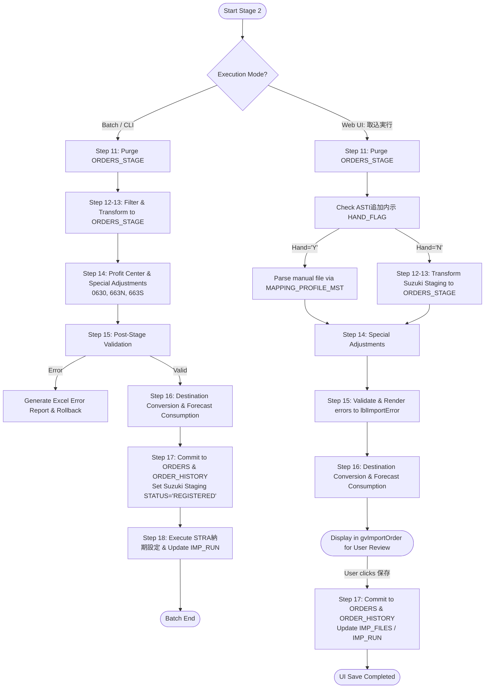

# 🚀 Implementation Plan: Stage 2 (Order Registration / SUZUKI_SPIRITS_DATA_IMPORT)

## 📋 Overview & Scope

In Stage 1 (`SUZUKI_SPIRITS_DATA_PRE_IMPORT`), the system successfully reads external Suzuki EDI/text files, validates file formats, sets `ACTIVE_FLAG = 'N'` on prior records, cross-references external customer item numbers against internal ASTI part numbers via `PRDSLSODRM`, generates Shift-JIS error lists, and commits valid raw rows into dedicated Suzuki staging tables (`SUZUKI_SPIRITS_...`).

**Stage 2 (`SUZUKI_SPIRITS_DATA_IMPORT`)** transforms these staged Suzuki records into the standard ASTI order staging table (`ORDERS_STAGE`), applies code-specific adjustments (`0630`, `663N`, `663S`), performs profit-center resolution and stage validation, executes destination conversion (`SUZUKI_SPIRITS_CONVERSION_MST`) and forecast consumption/reconciliation (`内示加工`, `受注残加工`, `納入指示加工`), commits valid rows into production master tables (`ORDERS` and `ORDER_HISTORY`), and executes downstream delivery date setting (`STRA納期設定`).

---

## 🎛️ Execution Mode Architecture

Stage 2 supports dual execution modes conforming to `docs/SUZUKI_SPIRITS_DATA_IMPORT.pdf` and `docs/SPIRITS_IMPORT_SPEC.md`:

---

## 🔄 Detailed 8-Step Workflow (Steps 11–18)

### Step 11: Stage Cleaning (`受注ワーク削除`)
* Physically purges `ORDERS_STAGE` where `CUSTOMER_SETTING_ID = Current Target` and `FOLDER_TYPE = Current Target`.

### Step 12 & 13: Order Data Filtering & `ORDERS_STAGE` Insert (`受注データチェック` / `INSERT ORDERS_STAGE`)
* Queries active staging records (`ACTIVE_FLAG = 'Y'`) from Suzuki dedicated tables for valid order `INFO_TYPE_CODE` values: `0600`, `0602`, `0650`, `0651`, `0813`, `0814`, `6604`, `6624` (skipping `0630`, `663N`, `663S` on initial insert).
* Transforms and inserts into `ORDERS_STAGE` with standard defaults & master lookups:
  * `COMPANY_ID`: Fixed `'1000'`
  * `BILLING_STANDARD`: Fixed `'S'`
  * `TRANSPORT_METHOD`: Fixed `2`
  * `STATUS`: Fixed `'IMPORTED'`, `ACTIVE_FLAG`: Fixed `'Y'`
  * `ORDER_TYPE`: `1` (内示) for `0600`, `0602`, `0813`, `6604`; `3` (納入指示) for `0650`, `0651`, `0814`, `6624`
  * `DEMAND_STATUS`: `'F'` (for `ORDER_TYPE = 1`), `'O'` (for `ORDER_TYPE = 3`)
  * `SHIP_PROCESS_TYPE`: `'O'` (for `ORDER_TYPE = 1`), `'K'` (for `ORDER_TYPE = 3`)
  * `DELIVERY_INSTR_FLAG`: `'N'` (for `ORDER_TYPE = 1`), `'Y'` (for `ORDER_TYPE = 3`)
  * `TOTAL_SHIP_QTY`: `NULL` (for `ORDER_TYPE = 1`), `0` (for `ORDER_TYPE = 3`)
  * `DUE_DATE`: Calculated via Oracle function `ADD_WORKING_DAYS2('00001', [DELIVERY_DATE], 0)` formatted as `yyyy/MM/dd`
  * `PRE_DAILY_DELIVERY_DATE`: Original unadjusted `DELIVERY_DATE`
  * `DEMAND_QTY` & `PRE_DAILY_ORDER_QTY`: Staging `ORDER_QTY`
  * `DEMAND_UNIT`: Joined from `ITEMM.FUNIT` where `ITEMM.FITEMNO = PRDSLSODRM.FPRDCD`
  * `SHIP_STOCK_LOCATION`: Joined from `ITEMM.FSHPWHCD` where `ITEMM.FITEMNO = ORDERS_STAGE.ITEM_NO`
  * `BILLING_TO`: Looked up from `SECTM.FBILLTOCD` via `GetBillingTo(CUSTOMER_CODE)`
  * `CURRENCY_CODE`: Looked up from `SECTM.FCURR` where `SECTM.FSECTCD = CUSTOMER_CODE`
  * `PRORATED_TYPE`: If `DELIVERY_DATE_TYPE` In ("1", "4") Then `2` (日割以外) Else `1` (日割り)
  * `CUSTOMER_INFO_TYPE`:
    * Converted from `ORDER_DATA_TYPE`: `1:内示` $\rightarrow$ `新規`, `2:確定` $\rightarrow$ `新規`, `3:変更` $\rightarrow$ `変更`.
    * Special `0651`: If 17th digit of `ORDER_NOTES` is not 0 $\rightarrow$ `打切`.
  * Extended Phase 2 attributes: `DELIVERY_TIME`, `CONTAINER_CAPACITY`, `INITIAL_FLAG`, `TARGET_REFERENCE_DATE_TYPE`, `TARGET_REFERENCE_DATE`, `INFO_TYPE_CODE`.

### Step 14: Special Demand & Delivery Adjustments (`受注ワーク更新`)
1. **Profit Center Resolution**:
   * For each staged row, retrieves Profit Center (`FUSRSTR1`) from `USRDEFFLDF` where `FTABLEID='ITEMM'` and `FRECKEY = PRODUCT_CODE`.
   * Queries `CUSTOMER_SETTING_MST` where `CUSTOMER_CODE = '5455'` and `PROFIT_CENTER = [FUSRSTR1]` and `ACTIVE_FLAG = 'Y'`.
   * If found, updates `ORDERS_STAGE.CUSTOMER_SETTING_ID`. If not found, keeps original setting ID.
2. **Code `0630` (増減 / Increment-Decrement)**:
   * For each active `0630` row in `SUZUKI_SPIRITS_0600AND0630`:
     * Matches in `ORDERS_STAGE` on `ITEM_NO`, `PRE_DAILY_DELIVERY_DATE`, `TARGET_REFERENCE_DATE_TYPE`, `TARGET_REFERENCE_DATE`, `INFO_TYPE_CODE = '0600'`.
     * If found in `ORDERS_STAGE`: updates `DEMAND_QTY = DEMAND_QTY + [0630_ORDER_QTY]` and `PRE_DAILY_ORDER_QTY`.
     * If not found in `ORDERS_STAGE`: fetches active `0600` record from master `ORDERS`, copies into `ORDERS_STAGE`, and updates quantity.
3. **Code `663N` (納期変更 / Due Date Change)**:
   * For each active `663N` row in `SUZUKI_SPIRITS_663NAND663SAND664T`:
     * Matches in `ORDERS_STAGE` on `CUSTOMER_ORDER_NO` and `INFO_TYPE_CODE = '6624'`.
     * If found in `ORDERS_STAGE`: updates `DUE_DATE = ADD_WORKING_DAYS2('00001', [663N_DELIVERY_DATE], 0)`.
     * If not found in `ORDERS_STAGE`: fetches active `6624` record from master `ORDERS`, copies into `ORDERS_STAGE`, and updates `DUE_DATE`.
4. **Code `663S` (数量変更 / Quantity Change)**:
   * For each active `663S` row in `SUZUKI_SPIRITS_663NAND663SAND664T`:
     * Matches in `ORDERS_STAGE` on `CUSTOMER_ORDER_NO` and `INFO_TYPE_CODE = '6624'`.
     * If found in `ORDERS_STAGE`: updates `DEMAND_QTY = [663S_ORDER_QTY]` and `PRE_DAILY_ORDER_QTY`.
     * If not found in `ORDERS_STAGE`: fetches active `6624` record from master `ORDERS`, copies into `ORDERS_STAGE`, and updates `DEMAND_QTY`.

### Step 15: Post-Stage Validation & File Settlement (`エラーチェック`)
* Validates staged data in `ORDERS_STAGE`:
  * Flags error if `CUSTOMER_SETTING_ID` belongs to generic customer `5455` with blank `PROFIT_CENTER` / `CUSTOMER_UNIT_ID` (unresolved profit center).
  * Validates standard required fields (`ITEM_NO`, `DUE_DATE`, `DEMAND_QTY > 0`, `SHIP_TO`).
* If errors exist:
  * Batch Mode: Generates Excel error report at `[FOLDER_PATH]\エラーリスト\ErrorList_*.xlsx`.
  * UI Mode: Renders error messages on screen (`lblImportError`).
  * Rollback / `DELETE FROM ORDERS_STAGE` for uncommitted stage rows.
  * Backup error file as `[OriginalFileName]_[UserID]_[Timestamp]`.
* If valid:
  * Proceeds to Step 16.

### Step 16: Forecast Processing & Conversion (`内示加工` / `受注残加工` / `納入指示加工`)
1. **内示加工 (Forecast Wash Replacement per `内示加工.pdf`)**:
   * Counts customer naiji ($x$: `SELF_FCST_FLAG = 'N'`) and ASTI naiji ($y$: `SELF_FCST_FLAG = 'Y'`).
   * **Case ① ($x \ge 1, y = 0$)**: Invalidate prior customer naiji (`SELF_FCST_FLAG = 'N'`) and auto-delete ASTI naiji (`SELF_FCST_DELETE_FLAG = 'Y'`).
   * **Case ② ($x = 0, y \ge 1$)**: Invalidate prior ASTI naiji (`SELF_FCST_FLAG = 'Y'`).
   * **Case ③ ($x \ge 1, y \ge 1$)**: Invalidate all prior naiji.
   * **Special Rule `0602`**: Contains no reference date fields; treated as brand new data (skips wash replacement).
   * Updates newly staged naiji records: `STATUS = 'PROCESSED'`.
2. **受注残加工 (Backlog Reconciliation per `受注残加工.pdf`)**:
   * If `RECONCILE_FLAG = 'Y'`:
     * Queries `STRA_ORDER_BACKLOG` and reconciles demand quantities against firm orders/naiji based on `RECONCILE_TYPE` (1: 順次, 2: 同月まで, 3: 同月のみ).
     * If `DEMAND_QTY = 0`: sets `STATUS = 'RECONCILED'`, `ACTIVE_FLAG = 'N'`.
3. **納入指示加工 (Delivery Processing & Consumption per `納入指示加工.pdf`)**:
   * **Step A (打切処理)**: Where `ORDER_TYPE = 3` and `INFO_TYPE = 'N'` $\rightarrow$ `STATUS = 'PROCESSED'`, `ACTIVE_FLAG = 'N'`.
   * **Step B (取消処理)**: Where `ORDER_TYPE = 3` and `INFO_TYPE = 'D'` $\rightarrow$ `DEMAND_QTY = 0`, `STATUS = 'PROCESSED'`.
   * **Step C (確定消込)**: If `RECONCILE_FLAG = 'Y'`, matches `CUSTOMER_ORDER_NO` against prior firm orders (`ORDER_TYPE = 2`) and deducts `DEMAND_QTY`.
   * **Step D (出荷先変換)**: Replaces `SHIP_TO` with `DELIVERY_CODE_PLAN` from `SUZUKI_SPIRITS_CONVERSION_MST` (where `DELIVERY_CODE_ORDER = SHIP_TO` and `ACTIVE_FLAG = 'Y'`).
   * **Step E (内示消込)**: If `FCST_RECONCILE_FLAG = 'Y'`:
     * `0650` / `0651` consumes active `0600` forecasts (matching converted `SHIP_TO`, `ITEM_NO`).
     * `0814` consumes active `0813` forecasts (matching converted `SHIP_TO`, `ITEM_NO`).
     * `6624` consumes active `6604` forecasts (matching converted `SHIP_TO`, `ITEM_NO`).
   * **Step F (新規納入指示確定)**: Where `ORDER_TYPE = 3` and `INFO_TYPE In ('I', NULL)` $\rightarrow$ `STATUS = 'PROCESSED'`.

### Step 17: Production Order Table Commitment (`INSERT ORDERS` / `INSERT ORDER_HISTORY`)
* Updates Suzuki staging table records (`STATUS = 'REGISTERED'`, `IMP_FILE_ID = :impFileId`).
* Copies valid rows from `ORDERS_STAGE` into master production table `ORDERS` (including extended attributes: `TARGET_REFERENCE_DATE_TYPE`, `TARGET_REFERENCE_DATE`, `INFO_TYPE_CODE`).
* Appends historical audit records into `ORDER_HISTORY` (including extended attributes).
* Inserts records into `IMP_FILES` (`STATUS = 'PARSED'`) and purges processed entries from `IMP_FILES_STAGE`.
* Moves any remaining work files to `COMPLETED` archive folder.

### Step 18: Completion Logging & STRA Integration (`UPDATE IMP_RUN` / `STRA納期設定`)
* **STRA Delivery Date Setting (`STRA納期設定` per `STRA納期設定ページ_受注取込後.pdf`)**:
  * For orders with `STATUS = 'PROCESSED'`, calculates lead times and updates delivery dates:
    * **(A)品揃リードタイム**: `SELECT FUSRDEC1 FROM USRDEFFLDF WHERE FTABLEID='ITEMM' AND FRECKEY = ORDERS_STAGE.ITEM_NO`
    * **輸送L/T**: `SELECT FTRANLT FROM SHPROUTM WHERE FSHPTOCD = ORDERS_STAGE.SHIP_TO AND FPRMWHCD = ORDERS_STAGE.SHIP_STOCK_LOCATION AND FPRIORITY = (SELECT MIN(FPRIORITY) FROM SHPROUTM ...)`
    * **出荷予定日 (`SHIP_SCHEDULED_DATE`)**: `ADD_WORKING_DAYS('00001', [希望納期], -(輸送L/T + 品揃L/T))`
    * **出荷日 (`SHIP_DATE`)**: `ADD_WORKING_DAYS('00001', [希望納期], -輸送L/T)`
    * **出荷計画日 (`SHIP_PLAN_DATE`)**: `ADD_WORKING_DAYS('00001', [希望納期], -(輸送L/T + 品揃L/T))`
    * Updates `ORDERS`: `SHIP_SCHEDULED_DATE`, `SHIP_DATE`, `SHIP_PLAN_DATE`, `STATUS = 'DUE_SET'`, `UPDATED_PG_ID = 'DueDateSetting(Order)'`.
    * Appends historical audit records into `ORDER_HISTORY` with `STATUS = 'DUE_SET'`.
* **Execution Run Finalization**:
  * Updates `IMP_RUN`: `ENDED_AT = SYSDATE`, `STATUS = 'COMPLETED'`, `FILE_COUNT`, `ROW_COUNT`, `ERROR_COUNT`.

---

## 📂 Proposed File Changes

### 1. `OMS.Business`
#### [MODIFY] [SuzukiDataImportService.vb](file:///c:/Dev/Projects/ASTI/OrderManagementSystem-dev/OMS.Business/Services/SuzukiDataImportService.vb)
* Implement full Stage 2 workflow methods:
  * `ExecuteOrderRegistration`: Entry point for Batch Mode (runs Steps 11 through 18).
  * `ExecuteStageImportToOrdersStage`: Entry point for Web UI Mode (runs Steps 11 through 16).
  * `ExecuteSaveOrders`: Commits `ORDERS_STAGE` to `ORDERS` and `ORDER_HISTORY` (Step 17).
  * Helper methods for code-specific adjustments (`0630`, `663N`, `663S`), profit center lookup, destination conversion, and forecast reconciliation.

### 2. `OMS.Data`
#### [MODIFY] [Spirits repositories under `OMS.Data\SUZUKI\`](file:///c:/Dev/Projects/ASTI/OrderManagementSystem-dev/OMS.Data/SUZUKI/)
* Add query methods to fetch active records (`ACTIVE_FLAG = 'Y'`) and update status (`STATUS = 'REGISTERED'`) for each Suzuki dedicated repository:
  * `Spirits0600And0630Repository.vb`
  * `Spirits0602Repository.vb`
  * `Spirits0650Repository.vb`
  * `Spirits0651Repository.vb`
  * `Spirits0814Repository.vb`
  * `Spirits6604And6634Repository.vb`
  * `Spirits6624Repository.vb`
  * `Spirits663NAnd663SAnd66Repository.vb`

#### [MODIFY] [OrderStageRepository.vb](file:///c:/Dev/Projects/ASTI/OrderManagementSystem-dev/OMS.Data/OrderStageRepository.vb)
* Ensure stage helper queries support Suzuki Phase 2 extended columns and Suzuki-specific consumption rules (`0650/0651 -> 0600`, `0814 -> 0813`, `6624 -> 6604`).

### 3. `OMS.Web`
#### [MODIFY] [OrderImport.aspx.vb](file:///c:/Dev/Projects/ASTI/OrderManagementSystem-dev/OMS.Web/Pages/Orders/OrderImport.aspx.vb)
* Integrate `SuzukiDataImportService` in `btnImportFile_Click` when `SpProcessType = 1`:
  * Handle ASTI manual forecasts (`HAND_FLAG = 'Y'`) via standard mapping profile.
  * Handle standard Suzuki staged tables (`HAND_FLAG = 'N'`) via `SuzukiDataImportService.ExecuteStageImportToOrdersStage`.
* Integrate `SuzukiDataImportService.ExecuteSaveOrders` in `btnSaveOrder_Click`.

---

## 🧪 Verification Plan

### Automated & Build Verification
- Compile entire solution (`OrderManagementSystem.sln`) with `MSBuild.exe` to verify 0 Errors and 0 Warnings.
- Run UTF-8 with BOM verification script across all modified/created files.

### Functional Verification
- Verify `SUZUKI_SPIRITS_DATA_PRE_IMPORT` CLI batch runner with sample EDI CSV files end-to-end against local Oracle DB:
  - Validate `ORDERS_STAGE` population with working calendar due dates (`ADD_WORKING_DAYS2`).
  - Validate `0630` quantity increment against `0600`.
  - Validate `663N` due date adjustment and `663S` quantity adjustment against `6624`.
  - Validate ship-to conversion via `SUZUKI_SPIRITS_CONVERSION_MST`.
  - Validate forecast consumption (`0650/0651` consumes `0600`, `6624` consumes `6604`).
  - Validate commitment to `ORDERS` and `ORDER_HISTORY`.
  - Validate `STRA納期設定` execution.
