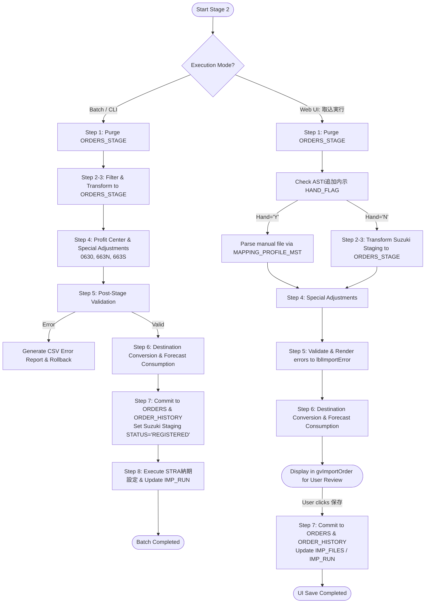

# 🚀 Implementation Plan: Stage 2 (Order Registration / SUZUKI_SPIRITS_DATA_IMPORT)

## 📋 Overview & Scope

In Stage 1 (`SUZUKI_SPIRITS_DATA_PRE_IMPORT`), incoming EDI/text files from Suzuki SPIRITS were validated, parsed, part-matched against `PRDSLSODRM`, and registered into dedicated Suzuki staging tables (`SUZUKI_SPIRITS_*`).

**Stage 2 (`SUZUKI_SPIRITS_DATA_IMPORT`)** transforms these staged Suzuki records into ASTI's standard order staging table (`ORDERS_STAGE`), applies code-specific adjustments (`0630`, `663N`, `663S`), resolves Profit Centers (`USRDEFFLDF`), performs stage error checks, executes destination conversions (`SUZUKI_SPIRITS_CONVERSION_MST`) and forecast consumption/reconciliations (`内示加工`, `受注残加工`, `納入指示加工`), commits valid rows into master production tables (`ORDERS` and `ORDER_HISTORY`), and executes downstream delivery date setting (`STRA納期設定`).

---

## 🎛️ Architecture & Dual Execution Flow

---

## 🔄 Detailed 8-Step Technical Implementation Plan

### Step 1: Stage Purge (`DELETE ① / 受注ワーク削除`)
* Physically purges `ORDERS_STAGE` where `CUSTOMER_SETTING_ID = Target` and `FOLDER_TYPE = Target`.

### Step 2 & 3: Order Data Filtering & `ORDERS_STAGE` Insert (`受注データチェック` / `INSERT ORDERS_STAGE`)
* Target Suzuki tables:
  * `SUZUKI_SPIRITS_0600AND0630` (`0600`)
  * `SUZUKI_SPIRITS_0602` (`0602`)
  * `SUZUKI_SPIRITS_0650` (`0650`)
  * `SUZUKI_SPIRITS_0651` (`0651`)
  * `SUZUKI_SPIRITS_0814` (`0814`)
  * `SUZUKI_SPIRITS_6604AND6634` (`6604`)
  * `SUZUKI_SPIRITS_6624` (`6624`)
  *(Note: `0630`, `663N`, `663S` are excluded from initial insert; updated in Step 4)*.
* Transforms and inserts into `ORDERS_STAGE`:
  * `COMPANY_ID`: Fixed `'1000'`, `BILLING_STANDARD`: Fixed `'S'`, `TRANSPORT_METHOD`: Fixed `2`
  * `ORDER_TYPE`: `1` (内示) for `0600`, `0602`, `6604`; `3` (納入指示) for `0650`, `0651`, `0814`, `6624`
  * `DEMAND_STATUS`: `'F'` (for `ORDER_TYPE = 1`), `'O'` (for `ORDER_TYPE = 3`)
  * `SHIP_PROCESS_TYPE`: `'O'` (for `ORDER_TYPE = 1`), `'K'` (for `ORDER_TYPE = 3`)
  * `DELIVERY_INSTR_FLAG`: `'N'` (for `ORDER_TYPE = 1`), `'Y'` (for `ORDER_TYPE = 3`)
  * `TOTAL_SHIP_QTY`: `NULL` (for `ORDER_TYPE = 1`), `0` (for `ORDER_TYPE = 3`)
  * `DUE_DATE`: Calculated via Oracle `ADD_WORKING_DAYS2('00001', [DELIVERY_DATE], 0)` formatted as `yyyy/MM/dd`
  * `PRE_DAILY_DELIVERY_DATE`: Original unadjusted `DELIVERY_DATE`
  * `DEMAND_QTY` & `PRE_DAILY_ORDER_QTY`: Staging `ORDER_QTY`
  * `DEMAND_UNIT`: Joined from `ITEMM.FUNIT` where `ITEMM.FITEMNO = PRDSLSODRM.FPRDCD`
  * `SHIP_STOCK_LOCATION`: Joined from `ITEMM.FSHPWHCD` where `ITEMM.FITEMNO = ORDERS_STAGE.ITEM_NO`
  * `BILLING_TO`: Looked up from `SECTM.FBILLTOCD` via `GetBillingTo(CUSTOMER_CODE)`
  * `CURRENCY_CODE`: Looked up from `SECTM.FCURR` where `SECTM.FSECTCD = CUSTOMER_CODE`
  * `PRORATED_TYPE`: If `DELIVERY_DATE_TYPE` In ("1", "4") Then `2` (日割以外) Else `1` (日割り)
  * Phase 2 Extended Attributes: `DELIVERY_TIME`, `CONTAINER_CAPACITY`, `INITIAL_FLAG`, `TARGET_REFERENCE_DATE_TYPE`, `TARGET_REFERENCE_DATE`, `INFO_TYPE_CODE`.

### Step 4: Special Demand & Delivery Adjustments (`UPDATE ① / 受注ワーク更新`)
1. **Profit Center Resolution**:
   * Retrieves `FUSRSTR1` from `USRDEFFLDF` where `FTABLEID='ITEMM'` and `FRECKEY = PRODUCT_CODE`.
   * Queries `CUSTOMER_SETTING_MST` where `CUSTOMER_CODE = '5455'` and `PROFIT_CENTER = [FUSRSTR1]` and `ACTIVE_FLAG = 'Y'`.
   * Updates `ORDERS_STAGE.CUSTOMER_SETTING_ID` with the resolved ID.
2. **Code `0630` (増減 / Increment-Decrement)**:
   * Matches `ORDERS_STAGE` on `ITEM_NO`, `PRE_DAILY_DELIVERY_DATE`, `TARGET_REFERENCE_DATE_TYPE`, `TARGET_REFERENCE_DATE`, `INFO_TYPE_CODE = '0600'`.
   * Updates `DEMAND_QTY = DEMAND_QTY + 0630.ORDER_QTY` and `PRE_DAILY_ORDER_QTY`.
   * If not in staging, falls back to fetch active `0600` from master `ORDERS`, copies to `ORDERS_STAGE`, and updates quantity.
3. **Code `663N` (納期変更 / Due Date Change)**:
   * Matches `ORDERS_STAGE` on `CUSTOMER_ORDER_NO` and `INFO_TYPE_CODE = '6624'`.
   * Updates `DUE_DATE = ADD_WORKING_DAYS2('00001', 663N.DELIVERY_DATE, 0)`.
   * If not in staging, falls back to fetch active `6624` from master `ORDERS`, copies to `ORDERS_STAGE`, and updates `DUE_DATE`.
4. **Code `663S` (数量変更 / Quantity Change)**:
   * Matches `ORDERS_STAGE` on `CUSTOMER_ORDER_NO` and `INFO_TYPE_CODE = '6624'`.
   * Updates `DEMAND_QTY = 663S.ORDER_QTY` and `PRE_DAILY_ORDER_QTY`.
   * If not in staging, falls back to fetch active `6624` from master `ORDERS`, copies to `ORDERS_STAGE`, and updates `DEMAND_QTY`.

### Step 5: Post-Stage Validation & Error Handling (`エラーチェック`)
* Validates staged data in `ORDERS_STAGE`:
  * Flags error if `CUSTOMER_SETTING_ID` has generic customer `5455` with blank `PROFIT_CENTER` / `CUSTOMER_UNIT_ID` (unresolved profit center).
  * Validates standard required fields (`ITEM_NO`, `DUE_DATE`, `DEMAND_QTY > 0`, `SHIP_TO`).
* If errors exist:
  * Batch Mode: Generates CSV error report in `[FOLDER_PATH]\エラーリスト\`.
  * UI Mode: Renders error messages in `lblImportError`.
  * Rollback / physical `DELETE` of uncommitted `ORDERS_STAGE` rows.
  * Backs up error file as `[OriginalFileName]_[UserID]_[Timestamp]`.

### Step 6: Forecast Processing & Conversion (`UPDATE ② / 内示加工・受注残加工・納入指示加工`)
1. **内示加工 (Forecast Replacement)**:
   * `INFO_TYPE_CODE = '0602'` (追加内示): Skips forecast replacement; always added as new active data.
   * Other forecast codes (`0600`, `6604`): Matches prior active records on `SHIP_TO`, `ITEM_NO`, `TARGET_REFERENCE_DATE_TYPE`, `TARGET_REFERENCE_DATE`, `INFO_TYPE_CODE`, `ACTIVE_FLAG = 'Y'`, and sets them to `ACTIVE_FLAG = 'N'`.
2. **出荷先変換 (`SUZUKI_SPIRITS_CONVERSION_MST`)**:
   * Queries `SUZUKI_SPIRITS_CONVERSION_MST` where `DELIVERY_CODE_ORDER = SHIP_TO` and `ACTIVE_FLAG = 'Y'`.
   * If found, converts `SHIP_TO = DELIVERY_CODE_PLAN`. If not found, retains original `SHIP_TO`.
3. **消込処理 (Forecast Consumption)**:
   * When `RECONCILE_FLAG = 'Y'`:
     * `0650` / `0651` consumes active `0600` forecasts (matching converted `SHIP_TO`, `ITEM_NO`).
     * `0814` consumes active `0813` forecasts (matching converted `SHIP_TO`, `ITEM_NO`).
     * `6624` consumes active `6604` forecasts (matching converted `SHIP_TO`, `ITEM_NO`).
     * Decrements forecast `DEMAND_QTY` sequentially or monthly per `RECONCILE_TYPE`.
   * When `FCST_RECONCILE_FLAG = 'Y'`:
     * Reconciles delivery instructions against active forecasts.

### Step 7: Master Production Table Commitment (`INSERT ORDERS` / `INSERT ORDER_HISTORY`)
* Copies valid rows from `ORDERS_STAGE` into master production table `ORDERS` (including Phase 2 extended columns).
* Appends audit history records to `ORDER_HISTORY`.
* Updates Suzuki staging tables to `STATUS = 'REGISTERED'`.
* Inserts records into `IMP_FILES` (`STATUS = 'PARSED'`) and deletes from `IMP_FILES_STAGE`.
* Moves physical files to `COMPLETED` directory.

### Step 8: Completion Logging & STRA Integration (`UPDATE IMP_RUN` / `STRA納期設定`)
* Updates `IMP_RUN`: `ENDED_AT = SYSDATE`, `STATUS = 'COMPLETED'`, `FILE_COUNT`, `ROW_COUNT`, `ERROR_COUNT`.
* **Batch Mode Only**: Executes downstream `OrderStageRepository.DeliveryDateSetting` (`STRA納期設定`) for customer `5455`.

---

## 📂 Proposed File Changes

### 1. `OMS.Business`
#### [MODIFY] [SuzukiDataImportService.vb](file:///c:/Dev/Projects/ASTI/OrderManagementSystem-dev/OMS.Business/Services/SuzukiDataImportService.vb)
* Implement full Stage 2 workflow:
  * `ExecuteOrderRegistration`: Batch Mode entry point (orchestrates Steps 1–8).
  * `ExecuteStageImportToOrdersStage`: Web UI Mode entry point (orchestrates Steps 1–6).
  * `ExecuteSaveOrders`: Commits `ORDERS_STAGE` to `ORDERS` and `ORDER_HISTORY` (Step 7).
  * Methods for Profit Center resolution, code adjustments (`0630`, `663N`, `663S`), ship-to conversion, and forecast consumption.

### 2. `OMS.Data`
#### [MODIFY] [Spirits repositories under `OMS.Data\SUZUKI\`](file:///c:/Dev/Projects/ASTI/OrderManagementSystem-dev/OMS.Data/SUZUKI/)
* Add query and status update methods (`GetActiveRows`, `UpdateStatusRegistered`) across:
  * `Spirits0600And0630Repository.vb`
  * `Spirits0602Repository.vb`
  * `Spirits0650Repository.vb`
  * `Spirits0651Repository.vb`
  * `Spirits0814Repository.vb`
  * `Spirits6604And6634Repository.vb`
  * `Spirits6624Repository.vb`
  * `Spirits663NAnd663SAnd66Repository.vb`

#### [MODIFY] [OrderStageRepository.vb](file:///c:/Dev/Projects/ASTI/OrderManagementSystem-dev/OMS.Data/OrderStageRepository.vb)
* Ensure stage and reconciliation queries correctly handle Suzuki conversion and consumption rules (`0650/0651 -> 0600`, `0814 -> 0813`, `6624 -> 6604`).

### 3. `OMS.Web`
#### [MODIFY] [OrderImport.aspx.vb](file:///c:/Dev/Projects/ASTI/OrderManagementSystem-dev/OMS.Web/Pages/Orders/OrderImport.aspx.vb)
* Hook `SuzukiDataImportService.ExecuteStageImportToOrdersStage` in `btnImportFile_Click` when `SpProcessType = 1`.
* Hook `SuzukiDataImportService.ExecuteSaveOrders` in `btnSaveOrder_Click`.

---

## 🧪 Verification Plan

### Automated Verification
- Verify UTF-8 BOM (`EF BB BF`) on all files.
- Compile entire solution with `MSBuild` to confirm 0 Errors and 0 Warnings.

### Functional Verification
- Test batch runner with sample EDI CSV files end-to-end against local Oracle DB:
  - Verify working calendar due date calculation (`ADD_WORKING_DAYS2`).
  - Verify `0630` quantity addition to `0600`.
  - Verify `663N` due date update and `663S` quantity update to `6624`.
  - Verify ship-to conversion via `SUZUKI_SPIRITS_CONVERSION_MST`.
  - Verify forecast consumption (`0650/0651` consumes `0600`, `6624` consumes `6604`).
  - Verify commitment to `ORDERS` and `ORDER_HISTORY`.
  - Verify `STRA納期設定` execution.
